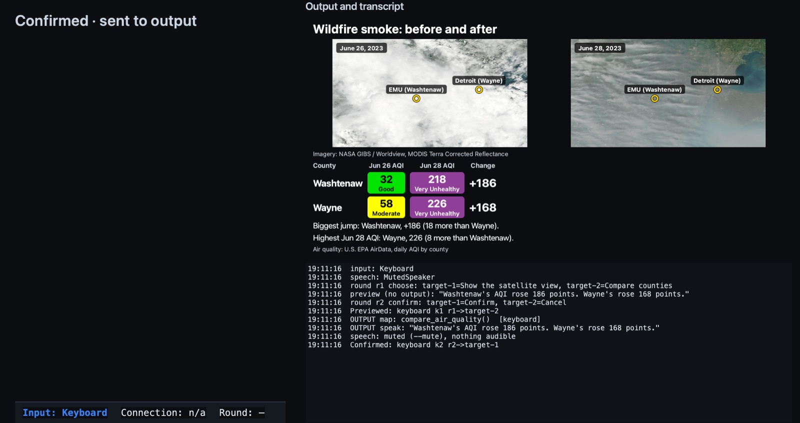
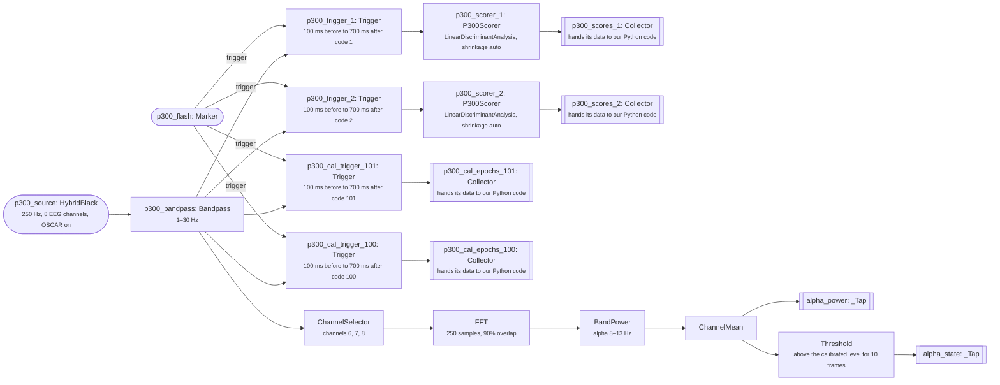

# Signal2Speech

**Answer without speaking or typing: pick, preview, and confirm the exact words with a brain-computer interface.**

Hack the Nest 2026 · Order of the Golden Eagles · built on g.tec **[g.Pype](https://gpype.gtec.at)** and the **Unicorn Hybrid Black**

A conversation partner asks a question and the app offers two answers. The wearer picks one with their brain signals (P300), sees exactly what will be said, and confirms by closing their eyes for two seconds (alpha switch). Nothing is spoken or shown until they confirm, and then it happens exactly once.



## Try it offline in three commands

Python 3.12. Works with Wi-Fi off once installed.

```
python -m venv .venv && .venv\Scripts\activate      # macOS/Linux: source .venv/bin/activate
pip install -r requirements-lock.txt
python -m signal2speech
```

A launcher opens with a button for each tool, and each button says which input it uses. Click **Demo · Keyboard**, then press **2** (Compare counties), then hold **1** for 2 s (confirm). The map changes and one line is spoken. Press **2** at the preview, or **Esc**, to cancel, and nothing happens.

The same tools without the launcher (`python -m signal2speech --help` lists them):

| Also try | Command |
| --- | --- |
| The demo with keyboard input | `python -m signal2speech.app --input keyboard` |
| Simulated brain signals through a real g.Pype pipeline | `python -m signal2speech.app --input simulated --sim 2,1` |
| **Recorded human EEG from g.tec's dataset chooses the tile**, as a walkthrough of a headset session (needs the dataset, see [For reviewers](#for-reviewers-reproduce-our-numbers-on-gtec-data)) | `python -m signal2speech.app --input recorded --recording path/to/S4.mat` |
| Keys choose, a simulated board's eye closure confirms. On two real PiEEG boards we measured no usable EEG ([findings](docs/eeg-hardware/README.md#pieeg-octopus-16-on-real-people-no-usable-eeg-2026-11-15)) | `python -m signal2speech.app --input pieeg --pieeg-self-test` |
| Phrase selection: type a question, pick one of two suggested replies, preview it, confirm, and it is spoken | `python -m signal2speech.ai` |
| The g.Pype evidence view (scopes, OSCAR, averaged P300) | `python -m signal2speech.evidence --source generator` |
| A hardware-free check of the whole demo | `python -m signal2speech.app --smoke` |

g.Pype runs on Windows 10/11 x64, Linux x86_64, and macOS 13+ on Apple silicon. Intel Macs can't use the Unicorn driver. Full setup is in the [launch path](docs/dev-setup-docs/README.md#python-and-gpype-launch-path-19) and the [platform notes](docs/dev-setup-docs/README.md#platform-notes).

## What works today

We label every input honestly, in the status pills along the bottom of the app and in this table.

| Input | Status |
| --- | --- |
| **Keyboard** | ✅ The full flow in the app: choose, preview, confirm or cancel, map reveal, and speech |
| **Simulated** (g.Pype `Generator`) | ✅ The same flow driven by a real g.Pype pipeline. ✅ Evidence view with a synthetic P300. |
| **Recorded** (g.tec's P300 Speller dataset) | ✅ Real recorded human EEG chooses the tile in the app: each flash is answered with one recorded brain response, and the live path's g.Pype pipeline and classifier calibrate on them and decide. Which tile counts as looked-at is scripted and the screen says "re-mapped to our tiles". It runs as a walkthrough of a headset session. ✅ The evidence view plays the same recordings. On them our classifier picks the right tile 94 % of the time from one flash and 100 % from five ([how](docs/eeg-hardware/README.md#how-many-flashes-the-chooser-needs-151)). |
| **Live EEG** (Unicorn Hybrid Black) | 🔧 The P300 chooser, alpha switch, evidence view, and a guided live-run harness (`python -m signal2speech.eeg.live --source hybridblack`) are built and pass on simulated input. They **haven't run on a real wearer yet**. The app takes live input (`python -m signal2speech.app --input live`): it calibrates on the app's tiles (P300, then 10 s eyes open and 10 s eyes closed), then the P300 chooser picks a tile and key 1 confirms. Eye-closure confirm stays off until a wearer run proves it's safe (then `--arm-live-confirm`) ([#23](https://github.com/Order-of-the-Golden-Eagles/Signal2Speech/issues/23), [#103](https://github.com/Order-of-the-Golden-Eagles/Signal2Speech/issues/103)). |
| **AI Answering** | ✅ Claude (`claude-sonnet-5-5`) suggests replies when an API key is in `.env`, grounded in the OpenOrbit data, and can offer a map action (compare counties or show the satellite view) whose spoken line comes from the dataset. Without a key, or offline, it uses clearly labelled practice replies or saved phrases. Real replies verified 11/14/26 (#106). |

## The demo question

**"Which county's AQI rose more when wildfire smoke reached southeast Michigan?"**

| Michigan county | June 26, 2023 | June 28, 2023 | Change |
| --- | ---: | ---: | ---: |
| Washtenaw (Eastern Michigan University) | 32 | 218 | **+186** |
| Wayne (Detroit) | 58 | 226 | **+168** |

The app answers out loud: *"Washtenaw's AQI rose 186 points. Wayne's rose 168 points."* NASA imagery shows the smoke from orbit. EPA data measures air quality at ground level.

Both map screens play NASA's daily images from June 24 to June 28, 2023, one day flowing into the next: ground visible on June 24, three days of cloud, then smoke on June 28. The cloudy days are shown as they were and labelled "mostly cloud". The air-quality numbers compare June 26 with June 28, the two days we hold EPA data for, and the screen says so.

## How it works

```
Unicorn Hybrid Black ─▶ g.Pype (OSCAR artifact removal, filters)
                          ├─▶ Epochs on our tiles' flashes ─▶ LDA ─▶ "choose tile 2"    (P300)
                          ├─▶ alpha band power ─▶ threshold ─▶ "confirm"                (eyes closed)
                          └─▶ scopes and averaged P300 for the judges                   (evidence)
keyboard / simulator ─────┘
        every input ─▶ one selection contract ─▶ preview ─▶ confirm ─▶ exactly one map action + one spoken line
```

- **Choose with P300, confirm with alpha.** They're different brain signals, so a leftover flash response can't confirm by accident.
- **One selection contract** for every input. Rounds, late or duplicate signals, and cancels are handled in one place ([selection contract](docs/architecture/selection-contract.md)).
- **One Python process**, fully offline: PySide6 for the screens, offline speech (a natural neural voice when [Piper is installed](docs/text-to-speech/README.md#a-natural-voice-piper-optional), the operating system's voice otherwise), and bundled NASA and EPA data. CI runs the tests on Windows, macOS, and Linux.

<details><summary><b>The real g.Pype graph</b> behind <code>--input live</code>, generated from the code (#166)</summary>

<!-- BEGIN generated pipeline diagram: app (hybridblack). python -m signal2speech.evidence.diagram --write -->

<!-- END generated pipeline diagram -->

Every mode, live and simulated: [our g.Pype pipelines](docs/architecture/pipelines.md).

</details>

A plain-language walkthrough is in [How Signal2Speech works](docs/architecture/README.md).

## For reviewers: reproduce our numbers on g.tec data

No hardware is needed. With g.tec's P300 Speller dataset (`S1.mat`–`S5.mat`, from the Data Science section of [github.com/unicorn-bi/Hackathon](https://github.com/unicorn-bi/Hackathon)) unpacked anywhere outside the repo:

```
python -m signal2speech.evidence.dataset path/to/p300-speller            # the numbers
python -m signal2speech.evidence.dataset path/to/p300-speller --curve    # accuracy by number of flashes
python -m signal2speech.evidence --source dataset path/to/p300-speller/S4.mat   # the live view
python -m signal2speech.app --input recorded --recording path/to/p300-speller/S4.mat   # it drives the app
```

The first command prints, per subject, the target minus non-target peak and our classifier's cross-validated single-flash accuracy (1–30 Hz band-pass, 100 ms bins, shrinkage LDA, 5 folds). On the published files we get a 7–11 µV difference in all five subjects and 0.59–0.85 balanced accuracy, where chance is 0.50 ([full table](docs/eeg-hardware/README.md#recorded-human-p300-from-gtecs-dataset-142)). Any file in the same format (`fs`, `y` as samples × channels, `trig` with +1 for target and −1 for non-target) works. The second command plays the recording through the same g.Pype pipeline the app uses, labelled Recorded.

The third command runs the whole app on that data. Every time one of our two tiles flashes, one real single-flash response from the recording is played into the pipeline: a response to an attended stimulus when the flashed tile is the scripted "attended" one, a response to an unattended stimulus otherwise. The same g.Pype pipeline and classifier as the live path then calibrate on those responses and pick the tile. The EEG and the classification are real. Which tile counts as attended is scripted, because the recorded person was looking at g.tec's speller and not at our tiles, so the app labels it `Recorded (g.tec dataset, re-mapped to our tiles)`. The confirm is a simulated eye closure and is labelled Simulated.

The same code reads a live g.tec Unicorn Hybrid Black (`--source hybridblack`), and it picks the right channels for each device by itself ([devices and channels](docs/eeg-hardware/README.md#devices-and-channels-150)).

## Team, credits, and AI use

- **Team:** Vasanth Anbukumar ([@vas2000-personal](https://github.com/vas2000-personal)), In Young Song ([@InYoung-Song](https://github.com/InYoung-Song)), Long Le ([@LongNguyenThanhLe](https://github.com/LongNguyenThanhLe)), [@MagicJester2764](https://github.com/MagicJester2764)
- **EEG:** g.tec [g.Pype](https://gpype.gtec.at) and the Unicorn Hybrid Black ([hackathon resources](https://github.com/unicorn-bi/Hackathon))
- **Imagery:** NASA GIBS / Worldview, MODIS Terra Corrected Reflectance
- **Air quality:** U.S. EPA AirData, daily AQI by county, 2023 ([sources and checks](data/openorbit/SOURCES.md))
- **AI use:** we used Claude (Anthropic) as a coding assistant, and the app can use Claude for reply suggestions. The wearer always previews and confirms the exact words. The EEG decoding is our own g.Pype pipeline, not an AI model.

## For developers

- [Engineering docs](docs/README.md), split by area, with the [shared memory](docs/MEMORY.md)
- [DEVLOG](DEVLOG.md): plain-language notes on every finished issue
- Tests: `pip install -e ".[dev]"`, then `pytest`. The repo's git hooks: `git config core.hooksPath .githooks`
- [Judging build runbook and rollback](docs/devops/judging-build.md)
