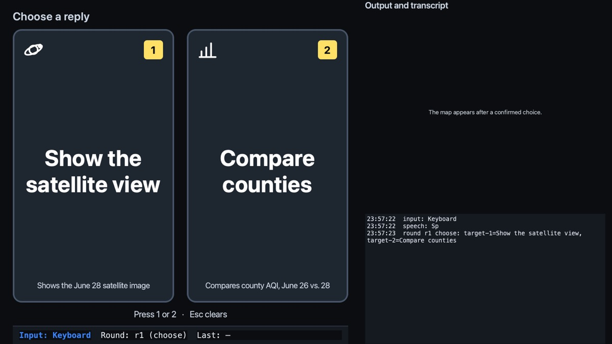
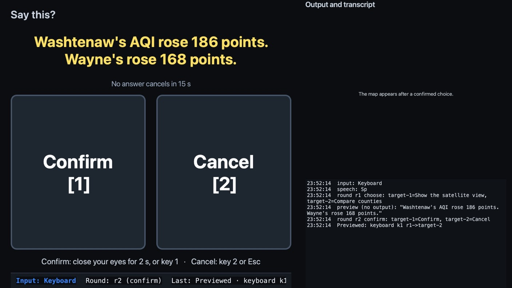
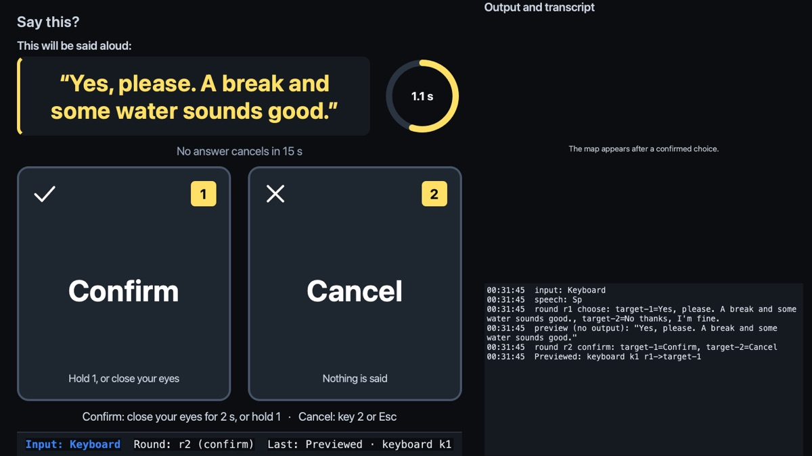
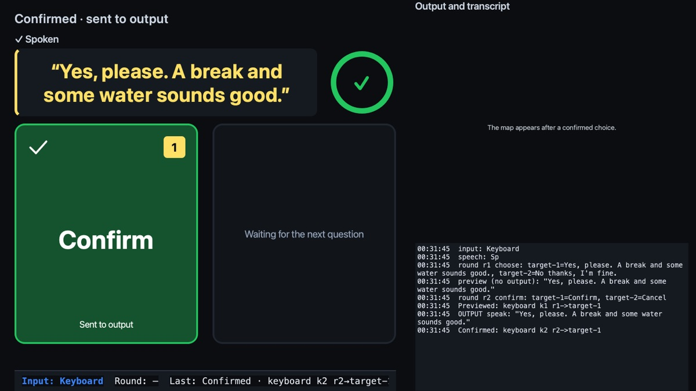

# Accessibility and UI

Keep choices stable during a round. Show the preview, confirm and cancel controls, connection state, and input mode.

**Active work** · [#4](https://github.com/Order-of-the-Golden-Eagles/Signal2Speech/issues/4)

**Consolidated issues** · [#3](https://github.com/Order-of-the-Golden-Eagles/Signal2Speech/issues/3)

## UI stack and layout

**Use PySide6 (Qt for Python), the same toolkit g.Pype's GUI is built on.** The choice tiles are our own Qt widgets. They flash for the P300 and send g.Pype `Marker` codes at each flash ([#46](https://github.com/Order-of-the-Golden-Eagles/Signal2Speech/issues/46)). The g.Pype evidence scopes ([#48](https://github.com/Order-of-the-Golden-Eagles/Signal2Speech/issues/48)) sit in the same window or a second one. The code lives in `signal2speech/ui/` ([#24](https://github.com/Order-of-the-Golden-Eagles/Signal2Speech/issues/24)). Run it standalone with keyboard input while the EEG tracks are in progress.

| Screen region | Content | Driven by |
| --- | --- | --- |
| **Choice tiles** | Two large flashing tiles, `target-1` and `target-2`, relabelled per round. Keys 1 and 2 select the same tiles. | `on_round_opened` |
| **Preview** | The exact reply or action text in large type, with **Confirm** (close your eyes for 2 s, or key 1) and **Cancel** (key 2 or Esc). | `on_preview` |
| **Judge strip** | Input label (Keyboard / Simulated / Recorded / Live EEG), connection state, current round ID, last outcome | `on_handled`, `on_cleared` |
| **OpenOrbit panel** | June 26 and June 28 imagery with county AQI and separate attribution. Revealed only after a confirm. | sink `execute` ([#30](https://github.com/Order-of-the-Golden-Eagles/Signal2Speech/issues/30), [#25](https://github.com/Order-of-the-Golden-Eagles/Signal2Speech/issues/25)) |
| **Question input** | A typed question from the conversation partner, on the judge side | [#27](https://github.com/Order-of-the-Golden-Eagles/Signal2Speech/issues/27) |

**Rules**

- The UI only renders handler events and calls `InputAdapter`. It never maps targets to actions, starts audio, or changes the map. See the [selection contract](../architecture/selection-contract.md).
- Freeze tile labels and positions for the whole round. Don't animate or reorder tiles while they flash. Flash timing must be steady, so send the `Marker` on the same frame the tile changes.
- A preview produces no audio and no map change. Cancel, disconnect, and reset return to a clean screen.
- Always show the input label so simulated input is never mistaken for live EEG.
- Use high contrast and large type (at least 48 px on tiles) so text is readable from the judge table.

## Running the UI (#24)

```
python -m signal2speech.ui            # keys 1/2 select, Esc cancels
python -m signal2speech.ui --flash    # flash tiles in Choose rounds, print each flash
python -m signal2speech.ui --keys 2 --screenshot out.png
```

The standalone sink only prints the `ConfirmedAction`. It plays no audio and changes no map. `pytest` includes the offscreen UI tests in `signal2speech/ui/tests/`.

- **Listeners:** `SelectionWindow` is driven only by `on_round_opened`, `on_preview`, `on_cleared`, and `on_handled`. The handler sends no `on_cleared` after a confirm, so the window clears itself on `Confirmed`. Key auto-repeat is off, so a held 2 can't preview and then cancel.
- **Input label:** call `window.set_input_source(InputSources.SIMULATED)`, or another source, to label the decoder feeding the handler. Call `set_connection(...)` for the headset state.
- **Flashes for #46:** pass `on_flash(target_id)`, `on_sequence_started` (call `eeg.arm_capture()` here), and `on_sequence_finished` to `SelectionWindow(..., flash=True)`. Each flash lights the tile, repaints it synchronously, and then calls `on_flash` in the same tick. Tune the timing with `window.flasher.flash_ms`, `isi_ms`, and `repetitions`. Only Choose rounds flash. Frame-accurate timing still needs checking on hardware.

## Judging laptop screen (#94)

- **Fits 1280×720 and up.** That's a 1080p laptop at 150% scaling. 1366×768 and 1536×864 (125%) are also checked. The app's smallest size is about 1190×521, and tests assert it stays within 1280×720 in the choose, preview, and reveal states. Tiles can shrink to 300 px wide.
- **Fullscreen:** `python -m signal2speech.app --fullscreen`. **F11** toggles it at any time.
- **F1** shows a key-help overlay for the operator: 1/2, Esc, D, F11, F1, and Ctrl+1/Ctrl+2 when the g.Pype simulator is active. It never touches the selection handler. Close it with F1 or a click.
- **Bottom strip on small screens:** the input label always shows in full. Connection and last-outcome text can clip, and their full text is in the tooltip and the transcript. With keyboard input the connection field is hidden, because there's nothing to report.
- **Long text shrinks to fit (#95).** Tile text starts at 56 px, and preview text at 44 px. If a long reply doesn't fit, the font steps down to a 32 px floor (`signal2speech/ui/fit.py`). Tiles recompute on relabel and resize, never on a flash, so flash timing stays steady. The preview is capped at about 28% of the window height so it doesn't squeeze the tiles. A 12-word AI reply fits at 1280×720 at 54 px.
- **Confirm countdown (#96).** During a Confirm round, a muted line under the preview reads "No answer cancels in N s". It reads the same timer as #26's timeout, so it can't disagree with when the cancel happens. It hides on confirm, cancel, disconnect, or a new question. With `--confirm-timeout 0` it never appears.

## Colour contrast (#135)

Every text colour lives in `signal2speech/ui/theme.py` (`palette.py` is a back-compat alias), and `tests/test_contrast.py` checks each pair against WCAG AA: 4.5:1, or 3:1 for bold text of 24 px or more. It also checks the help overlay drawn over a white flashing tile, and fails if a raw `#rrggbb` appears in the window or overlay code. The only fix needed was **Recorded**'s input-label purple: `#a855f7` (4.4:1) became `#c084fc`.

| Text | Colours | Contrast | Needs |
| --- | --- | ---: | ---: |
| label text | `#f5f7fa` on `#0b0d10` | 18.1:1 | 4.5:1 |
| prompt | `#cbd5e1` on `#0b0d10` | 13.1:1 | 4.5:1 |
| hint | `#cbd5e1` on `#0b0d10` | 13.1:1 | 4.5:1 |
| preview | `#ffe066` on `#0b0d10` | 14.9:1 | 3.0:1 |
| countdown | `#94a3b8` on `#0b0d10` | 7.6:1 | 4.5:1 |
| tile | `#ffffff` on `#1e2630` | 15.3:1 | 3.0:1 |
| tile while flashing | `#000000` on `#ffffff` | 21.0:1 | 3.0:1 |
| strip text | `#e2e8f0` on `#151a21` | 14.2:1 | 4.5:1 |
| input label keyboard | `#3b82f6` on `#151a21` | 4.8:1 | 4.5:1 |
| input label simulated | `#f59e0b` on `#151a21` | 8.1:1 | 4.5:1 |
| input label recorded | `#c084fc` on `#151a21` | 6.6:1 | 4.5:1 |
| input label live-eeg | `#22c55e` on `#151a21` | 7.7:1 | 4.5:1 |
| help text | `#f5f7fa` on `#0b0d10` | 18.1:1 | 4.5:1 |
| help keys | `#ffe066` on `#0b0d10` | 14.9:1 | 3.0:1 |
| help footer | `#94a3b8` on `#0b0d10` | 7.6:1 | 4.5:1 |

## One visual design (#174)

`signal2speech/ui/theme.py` is the single source for the look: colour roles (background, surface, raised, border, text, muted, quiet, accent, success), a type scale (56 / 44 / 36 / 28 / 22 / 18 px, with a 32 px floor for fitted text), spacing (4 / 8 / 16 / 24 / 32), and corner radii (8 / 14 / 20). The selection window, tiles, judge strip, help overlay, app shell and transcript, AI question panel, and launcher all take their styling from it. `tests/test_contrast.py` fails if any of them uses a raw colour code. The OpenOrbit map view keeps its own data-display styling (#30).

**Tiles** are drawn by hand: a small drawn icon (satellite, chart, speech bubble, check, cross), the fitted title, a one-line description of what happens, and the key as a corner badge instead of "[1]" in the title.

| State | Look |
| --- | --- |
| Idle | Raised surface, white title, muted description, yellow key badge |
| Flashing | **Plain white with black content, as before.** The badge is an outline, not a filled block, so the P300 stimulus is unchanged. Repaint takes about 3 ms (a test keeps the p95 under one 60 Hz frame). |
| Selected | Green fill and outline with a check, "Sent to output". It shows the confirmed choice until the next question. |
| Waiting | Dim surface, "Waiting for the next question" (no round open) |

| Before | After |
| --- | --- |
|  |  |
|  |  |

More after-shots: [flashing](media/174-after-2-flash.jpg), [selected](media/174-after-6-selected.jpg), [waiting](media/174-after-0-idle.jpg).

## The preview screen and the confirm ring (#175)

The preview is the consent screen. It shows:
- **What will happen:** "This will be said aloud:" or "This will show the map and say:"
- **The exact words**, as a large quotation
- **The confirm ring**, beside the words
- **The countdown** to automatic cancel, and the **Cancel** tile ("Nothing is said")

**The ring** (`signal2speech/ui/confirm_ring.py`) fills toward a confirm, and **nothing is spoken or shown before it's full**:

| Input | What fills the ring |
| --- | --- |
| Keyboard | **Holding 1 for 2 s.** Releasing early empties it. A tap no longer confirms (a tap still picks in a Choose round). |
| Simulated (scripted) | A simulated eye closure: the ring fills over the confirm delay, then confirms |
| Simulated or live alpha switch | The alpha switch's own progress: how far the latest band power is through its dwell, read through a Qt signal. The ring follows it and empties if the eyes open early. The alpha switch still makes the decision, so there's no double confirm. |

After a confirm, a **"✓ Spoken"** (or "✓ Shown and spoken") state keeps the words and a green check on screen until the next question. Typing a 1 in a text field (the AI question box) is never treated as key 1.

| Ready | Holding 1 | Spoken |
| --- | --- | --- |
|  |  |  |
