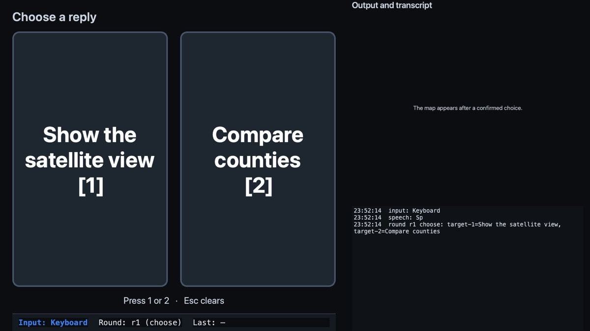
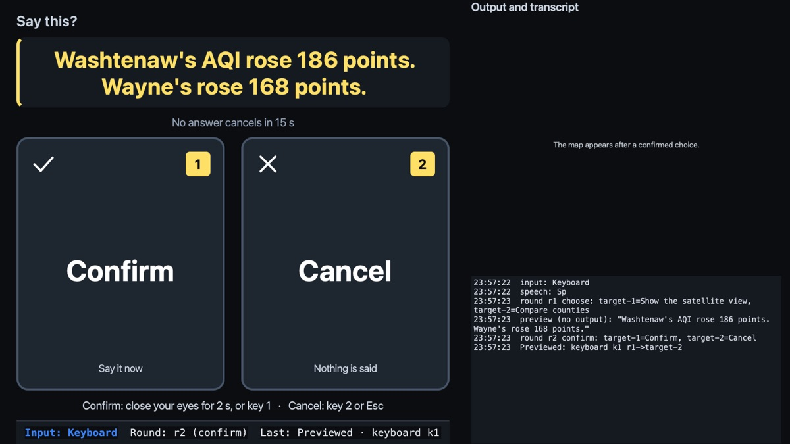
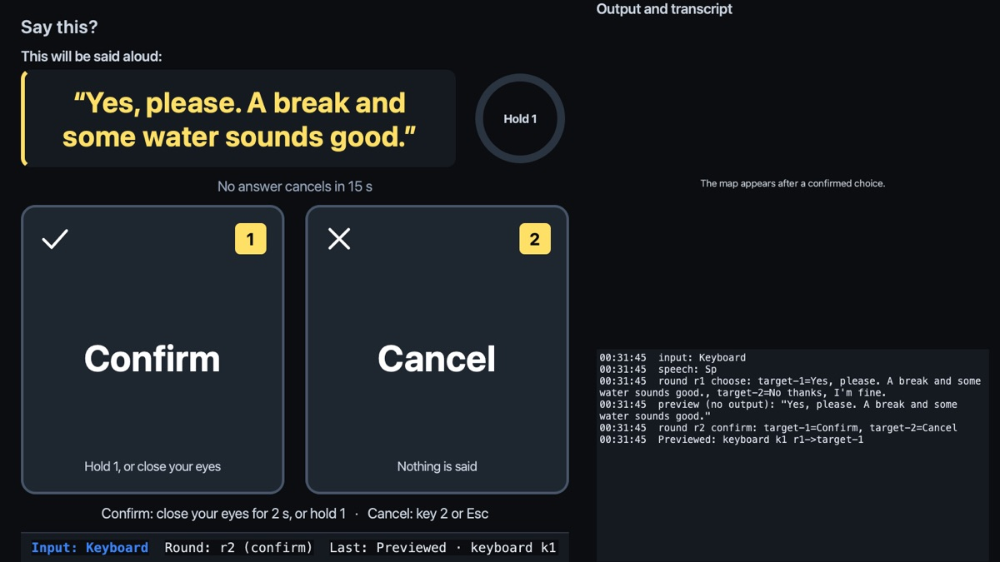
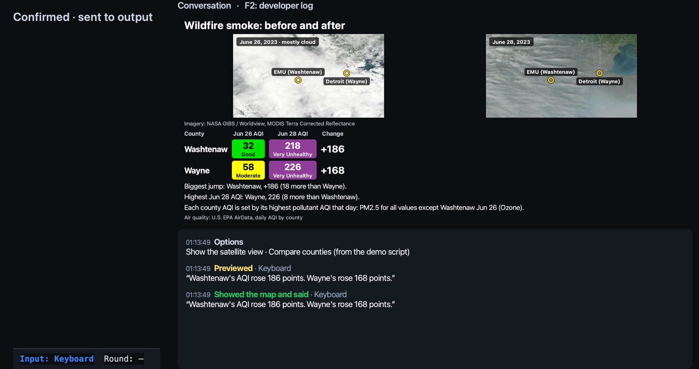
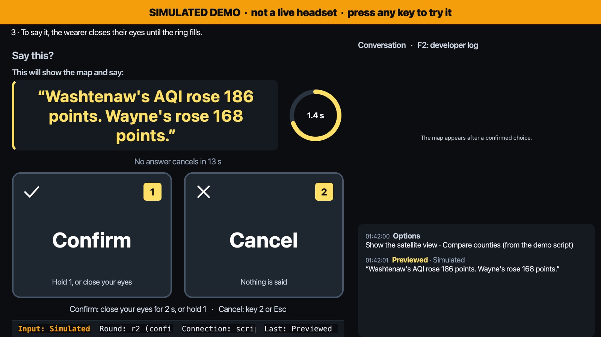
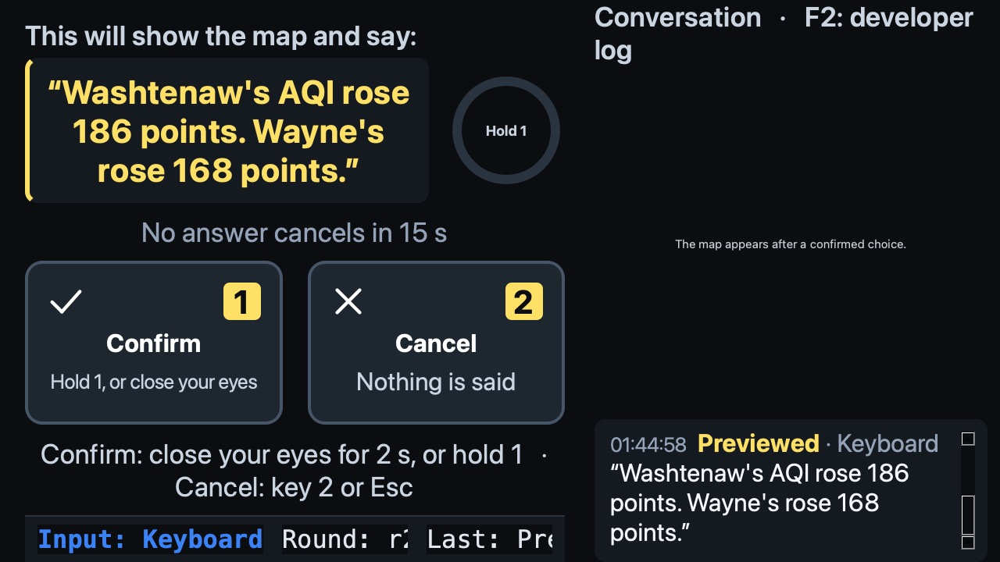
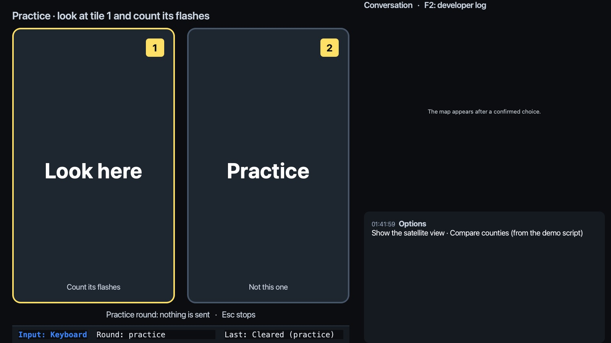
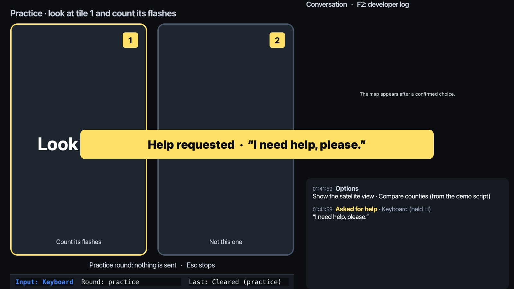

# Accessibility and UI

Keep choices stable during a round. Show the preview, confirm and cancel controls, connection state, and input mode.

**Active work** · [#4](https://github.com/Order-of-the-Golden-Eagles/Signal2Speech/issues/4)

**Consolidated issues** · [#3](https://github.com/Order-of-the-Golden-Eagles/Signal2Speech/issues/3)

## UI stack and layout

**Use PySide6 (Qt for Python), the same toolkit g.Pype's GUI is built on.** The choice tiles are our own Qt widgets. They flash for the P300 and send g.Pype `Marker` codes at each flash ([#46](https://github.com/Order-of-the-Golden-Eagles/Signal2Speech/issues/46)). The g.Pype evidence scopes ([#48](https://github.com/Order-of-the-Golden-Eagles/Signal2Speech/issues/48)) sit in the same window or a second one. The code lives in `signal2speech/ui/` ([#24](https://github.com/Order-of-the-Golden-Eagles/Signal2Speech/issues/24)). Run it standalone with keyboard input while the EEG tracks are in progress.

| Screen region | Content | Driven by |
| --- | --- | --- |
| **Choice tiles** | Two large flashing tiles, `target-1` and `target-2`, relabelled per round. Keys 1 and 2 select the same tiles. | `on_round_opened` |
| **Preview** | The exact reply or action text in large type, with **Confirm** (close your eyes for 2 s, or key 1) and **Cancel** (key 2 or Esc). | `on_preview` |
| **Judge strip** | Input label (Keyboard / Simulated / Recorded / Live EEG), connection state, current round ID, last outcome | `on_handled`, `on_cleared` |
| **OpenOrbit panel** | June 26 and June 28 imagery with county AQI and separate attribution. Revealed only after a confirm. | sink `execute` ([#30](https://github.com/Order-of-the-Golden-Eagles/Signal2Speech/issues/30), [#25](https://github.com/Order-of-the-Golden-Eagles/Signal2Speech/issues/25)) |
| **Question input** | A typed question from the conversation partner, on the judge side | [#27](https://github.com/Order-of-the-Golden-Eagles/Signal2Speech/issues/27) |

**Rules**

- The UI only renders handler events and calls `InputAdapter`. It never maps targets to actions, starts audio, or changes the map. See the [selection contract](../architecture/selection-contract.md).
- Freeze tile labels and positions for the whole round. Don't animate or reorder tiles while they flash. Flash timing must be steady, so send the `Marker` on the same frame the tile changes.
- A preview produces no audio and no map change. Cancel, disconnect, and reset return to a clean screen.
- Always show the input label so simulated input is never mistaken for live EEG.
- Use high contrast and large type (at least 48 px on tiles) so text is readable from the judge table.

## Running the UI (#24)

```
python -m signal2speech.ui            # keys 1/2 select, Esc cancels
python -m signal2speech.ui --flash    # flash tiles in Choose rounds, print each flash
python -m signal2speech.ui --keys 2 --screenshot out.png
```

The standalone sink only prints the `ConfirmedAction`. It plays no audio and changes no map. `pytest` includes the offscreen UI tests in `signal2speech/ui/tests/`.

- **Listeners:** `SelectionWindow` is driven only by `on_round_opened`, `on_preview`, `on_cleared`, and `on_handled`. The handler sends no `on_cleared` after a confirm, so the window clears itself on `Confirmed`. Key auto-repeat is off, so a held 2 can't preview and then cancel.
- **Input label:** call `window.set_input_source(InputSources.SIMULATED)`, or another source, to label the decoder feeding the handler. Call `set_connection(...)` for the headset state.
- **Flashes for #46:** pass `on_flash(target_id)`, `on_sequence_started` (call `eeg.arm_capture()` here), and `on_sequence_finished` to `SelectionWindow(..., flash=True)`. Each flash lights the tile, repaints it synchronously, and then calls `on_flash` in the same tick. Tune the timing with `window.flasher.flash_ms`, `isi_ms`, and `repetitions`. Only Choose rounds flash. Frame-accurate timing still needs checking on hardware.

## Judging laptop screen (#94)

- **Fits 1280×720 and up.** That's a 1080p laptop at 150% scaling. 1366×768 and 1536×864 (125%) are also checked. The app's smallest size is about 1190×521, and tests assert it stays within 1280×720 in the choose, preview, and reveal states. Tiles can shrink to 300 px wide.
- **Fullscreen:** `python -m signal2speech.app --fullscreen`. **F11** toggles it at any time.
- **F1** shows a key-help overlay for the operator: 1/2, Esc, D, F11, F1, and Ctrl+1/Ctrl+2 when the g.Pype simulator is active. It never touches the selection handler. Close it with F1 or a click.
- **Bottom strip on small screens:** the input label always shows in full. Connection and last-outcome text can clip, and their full text is in the tooltip and the transcript. With keyboard input the connection field is hidden, because there's nothing to report.
- **Long text shrinks to fit (#95).** Tile text starts at 56 px, and preview text at 44 px. If a long reply doesn't fit, the font steps down to a 32 px floor (`signal2speech/ui/fit.py`). Tiles recompute on relabel and resize, never on a flash, so flash timing stays steady. The preview is capped at about 28% of the window height so it doesn't squeeze the tiles. A 12-word AI reply fits at 1280×720 at 54 px.
- **Confirm countdown (#96).** During a Confirm round, a muted line under the preview reads "No answer cancels in N s". It reads the same timer as #26's timeout, so it can't disagree with when the cancel happens. It hides on confirm, cancel, disconnect, or a new question. With `--confirm-timeout 0` it never appears.

## Colour contrast (#135)

Every text colour lives in `signal2speech/ui/theme.py` (`palette.py` is a back-compat alias), and `tests/test_contrast.py` checks each pair against WCAG AA: 4.5:1, or 3:1 for bold text of 24 px or more. It also checks the help overlay drawn over a white flashing tile, and fails if a raw `#rrggbb` appears in the window or overlay code. The only fix needed was **Recorded**'s input-label purple: `#a855f7` (4.4:1) became `#c084fc`.

| Text | Colours | Contrast | Needs |
| --- | --- | ---: | ---: |
| label text | `#f5f7fa` on `#0b0d10` | 18.1:1 | 4.5:1 |
| prompt | `#cbd5e1` on `#0b0d10` | 13.1:1 | 4.5:1 |
| hint | `#cbd5e1` on `#0b0d10` | 13.1:1 | 4.5:1 |
| preview | `#ffe066` on `#0b0d10` | 14.9:1 | 3.0:1 |
| countdown | `#94a3b8` on `#0b0d10` | 7.6:1 | 4.5:1 |
| tile | `#ffffff` on `#1e2630` | 15.3:1 | 3.0:1 |
| tile while flashing | `#000000` on `#ffffff` | 21.0:1 | 3.0:1 |
| strip text | `#e2e8f0` on `#151a21` | 14.2:1 | 4.5:1 |
| input label keyboard | `#3b82f6` on `#151a21` | 4.8:1 | 4.5:1 |
| input label simulated | `#f59e0b` on `#151a21` | 8.1:1 | 4.5:1 |
| input label recorded | `#c084fc` on `#151a21` | 6.6:1 | 4.5:1 |
| input label live-eeg | `#22c55e` on `#151a21` | 7.7:1 | 4.5:1 |
| help text | `#f5f7fa` on `#0b0d10` | 18.1:1 | 4.5:1 |
| help keys | `#ffe066` on `#0b0d10` | 14.9:1 | 3.0:1 |
| help footer | `#94a3b8` on `#0b0d10` | 7.6:1 | 4.5:1 |
| conversation text | `#f5f7fa` on `#151a21` | 16.3:1 | 4.5:1 |
| conversation label | `#cbd5e1` on `#151a21` | 11.8:1 | 4.5:1 |
| conversation previewed | `#ffe066` on `#151a21` | 13.4:1 | 4.5:1 |
| conversation said | `#22c55e` on `#151a21` | 7.7:1 | 4.5:1 |
| conversation time / input | `#94a3b8` on `#151a21` | 6.8:1 | 4.5:1 |
| text size toast | `#f5f7fa` on `#1e2630` | 14.2:1 | 3.0:1 |
| help phrase banner | `#0b0d10` on `#ffe066` | 14.9:1 | 3.0:1 |
| attract banner | `#0b0d10` on `#f59e0b` | 9.1:1 | 3.0:1 |
| attract caption | `#f5f7fa` on `#0b0d10` | 18.1:1 | 4.5:1 |

## One visual design (#174)

`signal2speech/ui/theme.py` is the single source for the look: colour roles (background, surface, raised, border, text, muted, quiet, accent, success), a type scale (56 / 44 / 36 / 28 / 22 / 18 px, with a 32 px floor for fitted text), spacing (4 / 8 / 16 / 24 / 32), and corner radii (8 / 14 / 20). The selection window, tiles, judge strip, help overlay, app shell and transcript, AI question panel, and launcher all take their styling from it. `tests/test_contrast.py` fails if any of them uses a raw colour code. The OpenOrbit map view keeps its own data-display styling (#30).

**Tiles** are drawn by hand: a small drawn icon (satellite, chart, speech bubble, check, cross), the fitted title, a one-line description of what happens, and the key as a corner badge instead of "[1]" in the title.

| State | Look |
| --- | --- |
| Idle | Raised surface, white title, muted description, yellow key badge |
| Flashing | **Plain white with black content, as before.** The badge is an outline, not a filled block, so the P300 stimulus is unchanged. Repaint takes about 3 ms (a test keeps the p95 under one 60 Hz frame). |
| Selected | Green fill and outline with a check, "Sent to output". It shows the confirmed choice until the next question. |
| Waiting | Dim surface, "Waiting for the next question" (no round open) |

| Before | After |
| --- | --- |
|  |  |
|  |  |

More after-shots: [flashing](media/174-after-2-flash.jpg), [selected](media/174-after-6-selected.jpg), [waiting](media/174-after-0-idle.jpg).

## The preview screen and the confirm ring (#175)

The preview is the consent screen. It shows:
- **What will happen:** "This will be said aloud:" or "This will show the map and say:"
- **The exact words**, as a large quotation
- **The confirm ring**, beside the words
- **The countdown** to automatic cancel, and the **Cancel** tile ("Nothing is said")

**The ring** (`signal2speech/ui/confirm_ring.py`) fills toward a confirm, and **nothing is spoken or shown before it's full**:

| Input | What fills the ring |
| --- | --- |
| Keyboard | **Holding 1 for 2 s.** Releasing early empties it. A tap no longer confirms (a tap still picks in a Choose round). |
| Simulated (scripted) | A simulated eye closure: the ring fills over the confirm delay, then confirms |
| Simulated or live alpha switch | The alpha switch's own progress: how far the latest band power is through its dwell, read through a Qt signal. The ring follows it and empties if the eyes open early. The alpha switch still makes the decision, so there's no double confirm. |

After a confirm, a **"✓ Spoken"** (or "✓ Shown and spoken") state keeps the words and a green check on screen until the next question. Typing a 1 in a text field (the AI question box) is never treated as key 1.

| Ready | Holding 1 | Spoken |
| --- | --- | --- |
|  |  |  |

## Readable conversation (#176)

The panel under the map is now a conversation that a judge can read, not the raw log (`signal2speech/ui/conversation.py`). Each entry has a time, a label, and the input that caused it (Keyboard, Simulated, Recorded, or Live EEG):

| Label | When |
| --- | --- |
| Question | The AI demo heard or was typed a question |
| Options | A Choose round opened. It lists both choices and where they came from (the demo script, Claude, or the offline fallback). |
| Previewed | A choice was picked, with the quoted sentence that will be said |
| Said aloud / Showed the map and said | The confirm went to output. The text is the exact sentence that was spoken. |
| Nothing was said | Cancel ("The preview was cancelled."), timeout ("No answer in time, so the preview was cancelled."), or disconnect ("The headset disconnected, so nothing was said.") |

- **F2** swaps the conversation for the developer log (round ids, handler outcomes, timings). The log is unchanged and still feeds the console.
- Entries are built from the same handler events and output sink as the log, so the two can't disagree.
- The session report in `logs/` has a `## Conversation` section and a `## Developer log` section.



## Sound cues (#177)

A wearer with closed eyes can't see that a pick registered, so each event plays a short, quiet cue (`signal2speech/speech/cues.py`):

| Cue | Sound | When |
| --- | --- | --- |
| Preview | One soft note (E5) | A choice is previewed |
| Confirm | Two rising notes (C5 → G5) | A confirm. Speech starts after the cue ends, so they never overlap. The map changes at once. |
| Cancel | Two falling notes (A4 → E4) | Cancel, timeout, or disconnect |

- Each cue is 90–205 ms long at about a fifth of full volume, so it sits under the spoken reply.
- The tones are generated in code with the standard library (sine waves with a 10 ms fade, so there's no click). Nothing is downloaded, and there's no third-party audio to license.
- Turn them off with `--no-cues`. `--mute` also silences them. Tests use a fake player, so CI never plays sound.

## Attract mode (#193)

When nobody has touched the table for 60 s, the app loops a narrated walkthrough of one full pick: flashes, preview, confirm ring, map reveal, and the spoken reply. A large orange **SIMULATED DEMO · not a live headset** banner stays on screen for the whole loop. Captions above the screen explain each step, so the narration never talks over the reply.

- The loop is a second, self-contained app driven by the simulated input (the scripted g.Pype decoder when g.Pype is installed). Its picks go through its own handler and output path, so nothing reaches the real session or the report's counts. The report lists how many loops ran.
- Any key, click, or input on the real app stops it at once. That key doesn't also pick a tile. Speech still waiting in the loop is cancelled, and the real app is left on a clean first question.
- It never starts over an open preview, a map reveal, or a practice round.
- Turn it off with `--no-attract`. It is also off with `--keys` or `--screenshot`, in the AI demo, and with a board (`--input pieeg` or `--input live`): the eye check runs about 90 seconds with no key presses, and a simulated demo must never start over a wearer's calibration.



## Restart for the next visitor (#180)

Press **R** for a fresh first question from any state: a preview, a confirm countdown, a map reveal, a flash sequence, a practice round, or the attract loop. Nothing new appears on the map and nothing is spoken. The map panel goes back to blank, and a help banner from the last visitor is hidden. R is **refused while a headset or board is calibrating**, so it can't break a calibration; the developer log says so. In the AI demo (`python -m signal2speech.ai`), R also clears the question box, drops an AI reply that's still on its way, and opens the first question with saved phrases.

- **It goes through the selection contract, never around it.** An open round is ended with `handler.cancel("restart")`, then a new Choose round opens with `begin_choice_round`. A decision still in flight for the old round, such as an EEG flash sequence that was already running, arrives stale and is rejected (`RejectedStaleRound`).
- **It stops the map reveal, the confirm countdown, the app's own auto-reopen** (so exactly one new question opens), **and a reply still waiting for its sound cue.** During the attract loop R ends the loop and counts as a restart, still opening only one question. A practice round still logs its end.
- **The session report** counts it under **Other** (`Restarts (R): n`) and lists `restart (R)` in the timeline. A restart isn't counted as a cancel. The conversation shows "Restarted for the next visitor."
- **Tests:** `tests/test_restart.py` covers a restart during a preview (no output, one new round), a late EEG decision after the restart (stale), a restart during a reveal (no second output, map cleared), the real R shortcut and the report, a restart during practice (end still logged), the calibration guard, the help banner, R during attract (one round), and the AI demo (saved phrases, late AI reply dropped).
- **Still to do for #180:** the welcome screen after a short idle period. #193's attract loop already takes over after 60 s, so how the two fit together is being agreed with Long on #180.

## Text size (#195)

**Ctrl+=** and **Ctrl+-** step all app text through 80, 90, 100, 115, 130, 145, and 160%. **Ctrl+0** resets it. On macOS these are **Cmd+=**, **Cmd+-**, and **Cmd+0**. A toast shows the new size for 1.5 s. `--text-scale 1.3` starts at a given size.

- One factor in `theme.py` (`px()`) scales the tiles, preview, conversation, strip, help overlay, toast, and the AI question panel. The confirm ring keeps its size so its label stays inside the circle.
- At 160% everything still fits 1280×720. The preview reserves room for its fitted text and squeezes the tiles instead. During a preview the "Say this?" prompt hides, because the header already says what will happen. The round id in the strip may clip; the input label never does.
- The keys never touch the selection handler, and changing size mid-flash doesn't change flash timing (tested).



## Practice round (#196)

Press **P**, or start with `--practice`, for a 30 s warm-up before the first question. Tile 1 gets a yellow outline with "Look here · Count its flashes", and the screen runs real flash sequences at the demo's timing. Then it shows "Ready. Tile 1 flashed N times." and opens the first real question. **Esc** ends it early.

- It never sends anything. No question is open during practice, so no key or decoder can preview or confirm. It flashes with its own scheduler, so no decoder is armed and the simulated script isn't used up.
- It says **Practice** in the prompt, hint, and strip for the whole round, with any input.
- It won't start over an open preview. The report counts practice rounds separately.
- Not done yet: feeding live EEG calibration from it. That needs #23 and the calibration code's owner.



## Help phrase (#197)

**Hold H for 2 s** from any screen to say "I need help, please." once. A large yellow banner shows for 8 s, and the conversation and session report log it with its input.

- A tap does nothing, and auto-repeat is ignored. Typing H in the AI question box is left alone.
- It can't repeat within 10 s. It works from every state: waiting, choose, preview, reveal, help overlay, and practice. It never changes the current round, so an open preview still confirms or cancels normally.
- It goes through the app's one output path (`AppSink.call_for_help`) with its own outcome, so it never counts as a choice.
- `--help-by-eyes` adds a second trigger: eyes closed for 3 s past a full ring, outside a Confirm round only, so a normal confirm can't trigger it. This is off by default until it's tried on the headset.
- A test runs 400 random key taps and a full simulated run and checks there are zero help calls.


