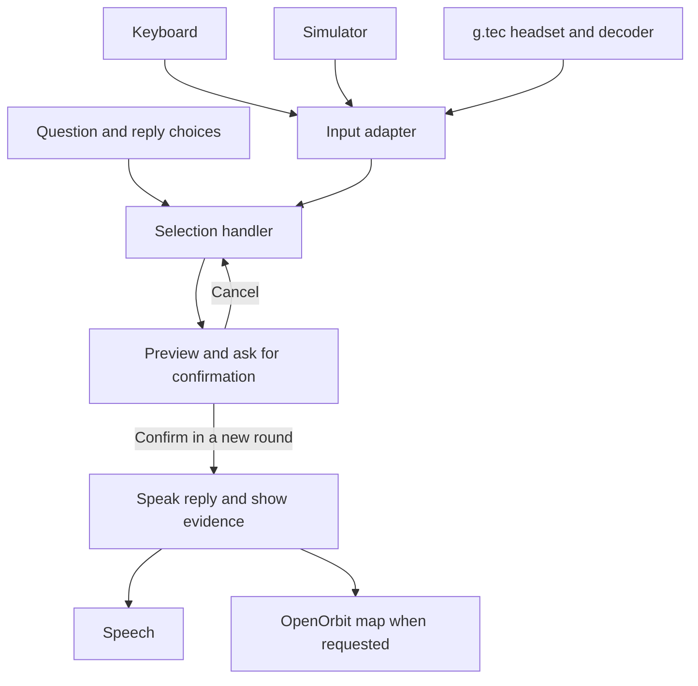

# How Signal2Speech works

Signal2Speech helps someone answer without speaking or typing. A conversation partner enters a question. The app shows a few possible replies or actions. The wearer uses the headset to pick one, sees exactly what the app will say or show, and makes a second choice to confirm it.

**AI Answering** supplies possible replies. **OpenOrbit** is a feature that can show NASA imagery alongside EPA air-quality readings. Both use the same controls.

**The g.Pype pipelines themselves** are drawn from the running code in [pipelines.md](pipelines.md) (#166): the app with live EEG, the evidence view, the P300 chooser, and the eye-closure switch, each live and simulated.

## Follow one answer

1. A judge asks, “Which county’s AQI rose more between June 26 and June 28, 2023?”
2. Signal2Speech offers **Show the satellite view** and **Compare counties**.
3. The wearer selects **Compare counties**. The app previews the reply and shows **Confirm** and **Cancel**.
4. The wearer selects **Confirm** in a new round. OpenOrbit updates the map and speaks, “Washtenaw’s AQI rose 186 points. Wayne’s rose 168 points.”

A **round** is one chance to choose from the options currently on screen. Choosing a reply and confirming it are two separate rounds. The headset’s software reports which on-screen target the wearer selected. The app decides what that target means in the current round.

## First demo host

**Python 3.12 + [g.Pype](https://gpype.gtec.at) + PySide6, in one process.** g.Pype reads the Unicorn Hybrid Black, cleans the signal with OSCAR, decodes choices, and draws the evidence scopes. A PySide6 window shows the tiles, preview, and OpenOrbit panel. g.Pype runs on Windows, macOS, and Linux, and needs no Unicorn Suite or licence for the Hybrid Black.

- **Choose:** our tiles flash, and a P300 classifier (g.Pype `Epochs` → `Sklearn` LDA) picks the attended tile ([#46](https://github.com/Order-of-the-Golden-Eagles/Signal2Speech/issues/46)).
- **Confirm:** a deliberate alpha switch, eyes closed for about 2 s (`BandPower` → `Threshold`) ([#47](https://github.com/Order-of-the-Golden-Eagles/Signal2Speech/issues/47)).
- **Evidence:** raw and filtered EEG, FFT, and averaged target vs. non-target responses for the judges ([#48](https://github.com/Order-of-the-Golden-Eagles/Signal2Speech/issues/48)).

Keyboard and g.Pype `Generator` input run through the same handler, so the team can work without the headset. Setup is in the [launch path](../dev-setup-docs/README.md#python-and-gpype-launch-path-19). *We switched from Unity on 2026-11-14 because the sponsor's judging criteria centre on g.Pype: visible pipelines, cross-platform support, and evidence.*

## Developer handoff

**The finalized contract, code, and tests are in [selection-contract.md](selection-contract.md).** It also covers folder ownership and issue dependencies. This section is the short version.

**Input adapter → selection handler → confirmed action → speech or OpenOrbit.**

The input adapter maps keys, simulated choices, and decoded headset classes to the same event. The following are three alternative inputs for the same visible option in the same example round. The app issues the round ID. The adapter issues the event ID and maps the source-specific input to an app target.

| Source | Example event |
| --- | --- |
| Keyboard | `{"source":"keyboard","roundId":"r1","eventId":"k1","targetId":"target-2"}` |
| Simulator or test input | `{"source":"simulated","roundId":"r1","eventId":"s1","targetId":"target-2"}` |
| Live headset | `{"source":"live-eeg","roundId":"r1","eventId":"e1","targetId":"target-2"}` |

- The app owns the visible options and their mapping. Example choice round `r1` maps `target-1` to `show_satellite` and `target-2` to `compare_air_quality`. Example confirmation round `r2` maps `target-1` to Confirm and `target-2` to Cancel. Our training labels define the classifier classes (`EegClassMap.default()`).
- Freeze options for the round. Accept one valid target from the active input source and consume the round before updating the UI or running an effect. Drop unknown targets, duplicate events, and events for any other round.
- On a preview, keep the exact text and action ID together. On a fresh Confirm, consume that pending choice before sending it to speech or the map, so a repeated callback cannot run it twice. Cancel, reset, or disconnect closes the round and clears the preview.
- g.Pype decisions arrive after the flash sequence ends. The adapter stamps the round when flashing **starts** (`arm_capture()`), so a late decision from the Choose round can't count as a confirmation. Keep live confirmation disarmed until [#23](https://github.com/Order-of-the-Golden-Eagles/Signal2Speech/issues/23) verifies it.

| Confirmed action | What happens |
| --- | --- |
| `speak_reply` | Speak the exact previewed reply the wearer approved. |
| `show_satellite` | Show the June 28 NASA MODIS image and speak its short explanation. |
| `compare_air_quality` | Show the June 26–28 NASA imagery and county AQI comparison, then speak the computed result. |

### First integration check

Send any one of the example events for `r1`. Expect a preview and no speech or map change. Replay it while `r2` is active. Expect no change. Send a fresh `r2` selection of `target-1`. Expect the AQI reveal and one spoken reply. Repeat that confirmation to check for duplicate output. In a separate run, select Cancel or disconnect during preview. Expect silence and no map change.

These are the handoff examples for [headset input (#2)](https://github.com/Order-of-the-Golden-Eagles/Signal2Speech/issues/2) and [integration (#4)](https://github.com/Order-of-the-Golden-Eagles/Signal2Speech/issues/4). Keyboard and simulated g.Pype input now run end to end in `python -m signal2speech.app`. Live headset timing and class mapping still need [#23](https://github.com/Order-of-the-Golden-Eagles/Signal2Speech/issues/23). See [Current status](selection-contract.md#current-status). [Architecture issue #1](https://github.com/Order-of-the-Golden-Eagles/Signal2Speech/issues/1)
