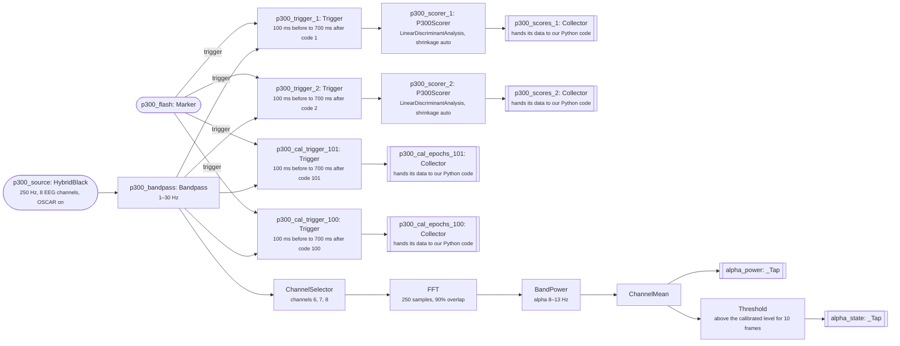
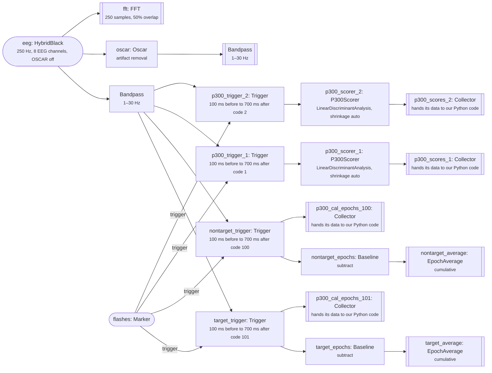
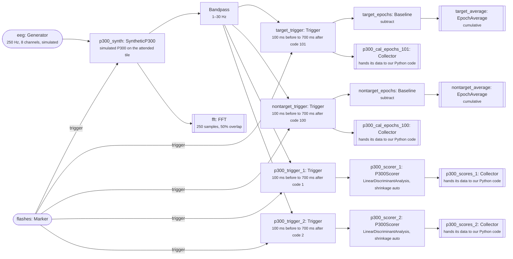
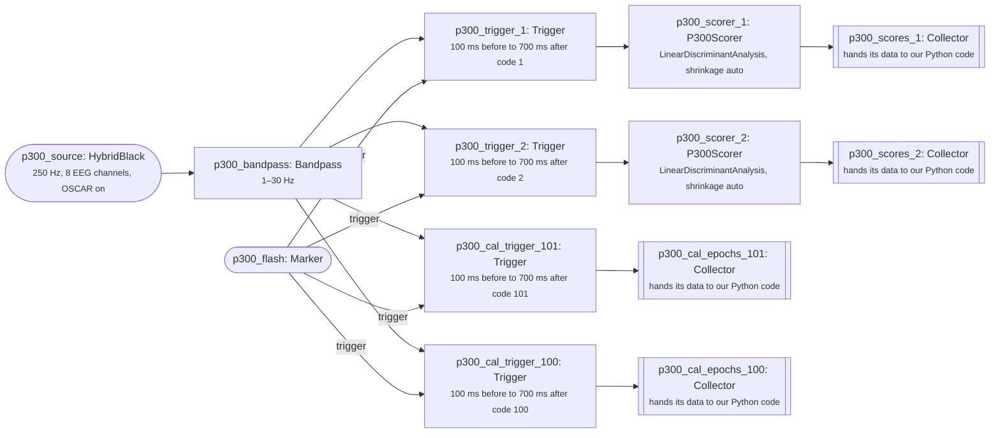
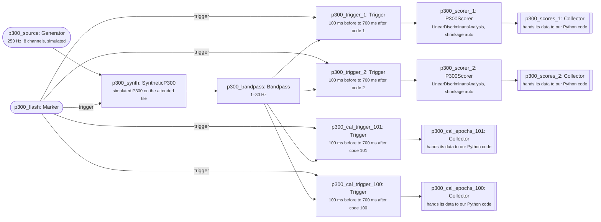
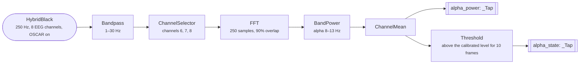
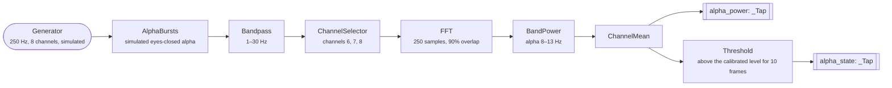

# Our g.Pype pipelines (generated)

Generated by `python -m signal2speech.evidence.diagram --write` from the real pipeline objects (#166): each mode calls the same builder the app or tool uses and walks g.Pype's `Pipeline.serialize()`. Don't edit the diagrams by hand. `tests/test_diagram.py` fails when they're out of date.

Rounded boxes are sources, double boxes are ends of the graph. Edge labels name the ports that aren't the default `out` → `in` (for example a Trigger's `trigger` input, which takes the flash markers). `Collector` and `_Tap` nodes hand data to our Python code: the classifier's scores, the alpha switch's power and state. The evidence view's scopes and spectrum attach to its nodes when its window opens, so the nodes they read (the raw filter and the FFT) show here as ends.

## The app with live EEG (`python -m signal2speech.app --input live`): Live EEG: g.tec Unicorn Hybrid Black

<!-- BEGIN generated pipeline diagram: app (hybridblack). python -m signal2speech.evidence.diagram --write -->

<!-- END generated pipeline diagram -->

## The evidence view (`python -m signal2speech.evidence --p300`): Live EEG: g.tec Unicorn Hybrid Black

<!-- BEGIN generated pipeline diagram: evidence (hybridblack). python -m signal2speech.evidence.diagram --write -->

<!-- END generated pipeline diagram -->

## The evidence view (`python -m signal2speech.evidence --p300`): Simulated: g.Pype Generator

<!-- BEGIN generated pipeline diagram: evidence (generator). python -m signal2speech.evidence.diagram --write -->

<!-- END generated pipeline diagram -->

## The P300 chooser (`python -m signal2speech.eeg.p300`): Live EEG: g.tec Unicorn Hybrid Black

<!-- BEGIN generated pipeline diagram: p300 (hybridblack). python -m signal2speech.evidence.diagram --write -->

<!-- END generated pipeline diagram -->

## The P300 chooser (`python -m signal2speech.eeg.p300`): Simulated: g.Pype Generator

<!-- BEGIN generated pipeline diagram: p300 (generator). python -m signal2speech.evidence.diagram --write -->

<!-- END generated pipeline diagram -->

## The eye-closure switch on its own (`python -m signal2speech.eeg.alpha_confirm`): Live EEG: g.tec Unicorn Hybrid Black

<!-- BEGIN generated pipeline diagram: alpha (hybridblack). python -m signal2speech.evidence.diagram --write -->

<!-- END generated pipeline diagram -->

## The eye-closure switch on its own (`python -m signal2speech.eeg.alpha_confirm`): Simulated: g.Pype Generator

<!-- BEGIN generated pipeline diagram: alpha (generator). python -m signal2speech.evidence.diagram --write -->

<!-- END generated pipeline diagram -->

Simulated `--input simulated --p300` runs the chooser drawn under the P300 chooser (Simulated), and its alpha switch on a second Generator with simulated alpha bursts, drawn under the eye-closure switch (Simulated).
