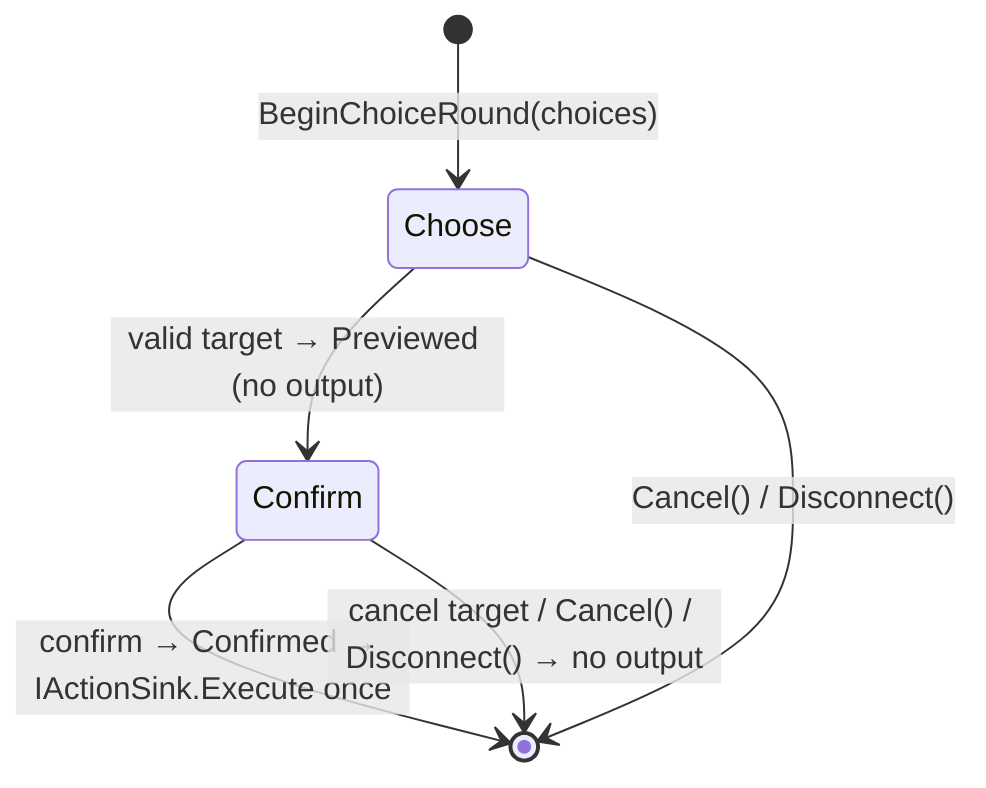
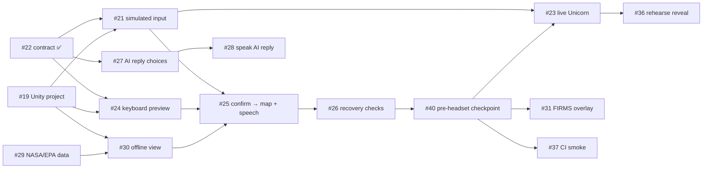

# Selection contract

This is the shared contract from [#22](https://github.com/Order-of-the-Golden-Eagles/Signal2Speech/issues/22). Every input source and every output builds against it. The code is in [`core/`](../../core), and the executable spec is [`contracts/selection-scenarios.json`](../../contracts/selection-scenarios.json). If you change a rule, change the scenario file and the code in the same PR.

## Vendor facts vs. app decisions

| | What we know | Status |
| --- | --- | --- |
| **Vendor fact** | The g.tec Unity ERP starter raises an `On Class Selection` callback with a decoded class index. [Tutorial](https://github.com/unicorn-bi/Unicorn-Hybrid-Black-Unity-Interface/blob/main/tutorial/build-your-first-erp-application.md#advance-unity-event-callbacks) | Documented, not yet run by us |
| **Vendor fact** | The published callback example carries no app round ID. | Documented |
| **Vendor fact** | The callback signature is `OnClassificationSelection(ERPPipeline erpPipeline, ClassSelection classSelection)`, and it reads `classSelection.Class`. Wire it on the **ERPPipeline** object's **On Class Selection** event. | Documented |
| **Vendor fact** | **BCI Visual ERP 3D** ships 5 `ERPFlashTag3D` targets. We use 2. | Documented |
| **Vendor fact** | Serial `UN-0000.00.00` is a built-in **Unicorn simulator**. Training needs at least 30 trials (60 recommended). The SDK targets Unity 2022.3 (2022.3.11f1 recommended). | Documented |
| **Unknown** | The class index to on-screen target mapping in the installed scene. | Record in [#23](https://github.com/Order-of-the-Golden-Eagles/Signal2Speech/issues/23). Code uses `EegClassMap.AssumedDefault()` (1 → `target-1`, 2 → `target-2`) until then. |
| **Unknown** | Whether a late callback can arrive after the next stimulus sequence starts. | Verify in [#23](https://github.com/Order-of-the-Golden-Eagles/Signal2Speech/issues/23). |
| **App decision** | Everything below. | Implemented in `core/` and covered by tests |

## Event shape

All input sources produce the same shape:

```json
{"source":"keyboard","roundId":"r1","eventId":"k1","targetId":"target-2"}
```

| Field | Values | Who sets it |
| --- | --- | --- |
| `source` | `keyboard`, `simulated`, `recorded`, `live-eeg` | The adapter. Label input honestly in logs and the demo. |
| `roundId` | `r1`, `r2`, … | The app issues it, and the adapter stamps it **when the input is captured**, not when it arrives. |
| `eventId` | `k1`, `s1`, `rec1`, `e1`, … | The adapter. Unique per run. |
| `targetId` | `target-1`, `target-2` | The adapter maps keys, simulator picks, or EEG classes onto it. |

In C#, this is `SelectionEvent`. Its fields are lowercase so Unity's `JsonUtility` and `System.Text.Json` read the JSON as is.

## IDs

**Targets** are on-screen slots. Their meaning changes with each round.

| Round kind | `target-1` | `target-2` |
| --- | --- | --- |
| Choose (OpenOrbit demo, [`demo-round.json`](../../contracts/demo-round.json)) | `show_satellite` | `compare_air_quality` |
| Choose (AI Answering, #27) | `speak_reply` (reply A) | `speak_reply` (reply B) |
| Confirm (always) | `confirm` | `cancel` |

**Actions** are stable strings in `ActionIds`. Only these three ever reach output:

| Action | Effect after confirmation |
| --- | --- |
| `show_satellite` | Show the June 28 NASA MODIS image and speak its line. |
| `compare_air_quality` | Show the June 26 and June 28 imagery with the county AQI comparison, then speak "Washtenaw's AQI rose 186 points. Wayne's rose 168 points." |
| `speak_reply` | Speak the exact previewed reply. |

## Round rules (`SelectionHandler`)



1. The app opens a round with frozen options. Each round gets a new ID.
2. The first valid event **consumes** the round before any UI update or effect runs.
3. In a Choose round, a valid pick only previews. The handler stores the exact text with the action ID and opens a Confirm round.
4. A fresh Confirm sends a `ConfirmedAction` to `IActionSink` exactly once and clears the pending choice. The app then calls `BeginChoiceRound` for the next question.
5. These are rejected without output. The round stays as it was:

| Outcome | Cause |
| --- | --- |
| `RejectedStaleRound` | The `roundId` doesn't match the open round. This includes a late EEG callback from the Choose round. |
| `RejectedDuplicateEvent` | The `eventId` was already accepted. |
| `RejectedRoundConsumed` | The round already accepted an event. |
| `RejectedNoOpenRound` | Nothing is on screen, for example after a confirm, cancel, or disconnect. |
| `RejectedUnknownTarget` / `RejectedUnknownSource` / `RejectedMalformed` | The input doesn't match the contract. |
| `RejectedLiveConfirmDisarmed` | A `live-eeg` Confirm arrived while `LiveEegConfirmArmed` is false (the default). Keyboard or simulated input can still confirm. #23 decides when to arm it. |

### Sample events

Use these against [`demo-round.json`](../../contracts/demo-round.json):

| File | Event | Result |
| --- | --- | --- |
| [`preview.json`](../../contracts/events/preview.json) | `keyboard`, `r1`, `k1`, `target-2` | `Previewed` "Compare counties". Opens Confirm round `r2`. No output. |
| [`stale.json`](../../contracts/events/stale.json) | `live-eeg`, `r1`, `e7`, `target-1` | `RejectedStaleRound`. A late `r1` callback can't confirm in `r2`. |
| [`confirm-fresh.json`](../../contracts/events/confirm-fresh.json) | `keyboard`, `r2`, `k2`, `target-1` | `Confirmed`. One `compare_air_quality` effect and one spoken line. |

## Plugging in

```csharp
var handler = new SelectionHandler(sink);            // sink: IActionSink, owned by #25
var keyboard = new InputAdapter(handler, InputSources.Keyboard);
var eeg      = new InputAdapter(handler, InputSources.LiveEeg);
var classMap = EegClassMap.AssumedDefault();         // replace after #23

handler.RoundOpened += round => ui.Show(round);      // #24
handler.PreviewShown += choice => ui.Preview(choice);// #24, no audio and no map change
handler.Cleared += reason => ui.Reset(reason);
handler.Handled += (e, outcome) => log.Write(e, outcome); // #41 diagnostics

handler.BeginChoiceRound(demoChoices);
keyboard.SelectNow(TargetIds.Target2);               // keys 1 and 2
eeg.ArmCapture();                                    // when flashing starts for the open round
eeg.SelectCaptured(classMap.TargetFor(classIndex));  // from On Class Selection, on the main thread
```

- **Simulated input (#21):** prefer the vendor simulator `UN-0000.00.00` driving the real `On Class Selection` callback, labelled `simulated`. If that's unavailable, inject at the same boundary with `new InputAdapter(handler, InputSources.Simulated)`, then `ArmCapture` and `SelectCaptured`.
- **Threading:** `SelectionHandler` isn't thread-safe. Marshal vendor callbacks to the Unity main thread first.

## Tests

- `dotnet test core/DotNetTests~` runs in about 2 seconds without Unity. The `~` suffix keeps Unity from importing that folder.
- In Unity, add `core` as a local package (`"com.goldeneagles.signal2speech.core": "file:../../../core"` in `Packages/manifest.json`). Then run the EditMode tests in the Test Runner. This path is untested until #19 creates the project.

## Repo layout and ownership

Each track owns one folder, so parallel PRs don't conflict. Don't edit another track's folder without telling its owner.

| Path | Owner issue | Notes |
| --- | --- | --- |
| `contracts/`, `core/` | #22 | Shared. Changes need a scenario update and a heads-up to every track. |
| `unity/Signal2Speech/` (project, `Packages/`, `ProjectSettings/`) | #19 | Creates the project from the sponsor starter and adds the `core` package. |
| `…/Assets/Signal2Speech/Input/` | #21 | Simulated adapter, EEG callback glue, class map |
| `…/Assets/Signal2Speech/UI/` | #24 | Choice, preview, and Confirm/Cancel screens, plus keys 1 and 2 |
| `data/openorbit/` | #29 | MODIS images, AQI rows, `SOURCES.md` |
| `…/Assets/Signal2Speech/OpenOrbit/` | #30 | Comparison view. Exposes `show_satellite` and `compare_air_quality`. |
| `…/Assets/Signal2Speech/Speech/`, `…/Scenes/Demo.unity` | #25 | `IActionSink` implementation, audio, and the one integration scene |
| `…/Assets/Signal2Speech/AiAnswering/` | #27 | Reply suggestions as `speak_reply` choices |
| `…/Assets/Signal2Speech/Scenes/Dev/<track>.unity` | each track | Build and test in your own scene. Only #25 edits `Demo.unity`. |

## Dependency order



GitHub tracks the same edges as **Blocked by** relationships on each issue.
