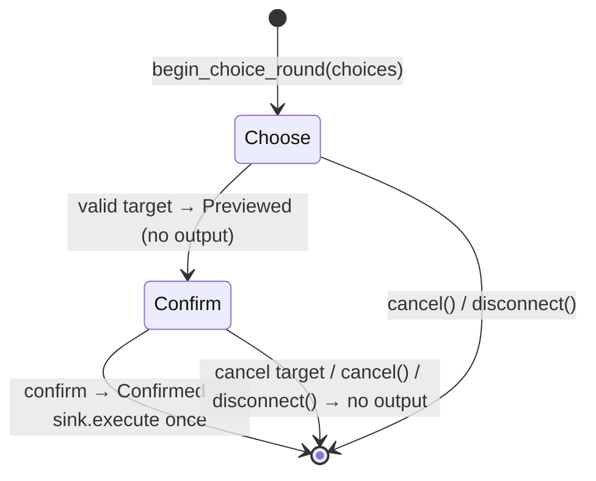
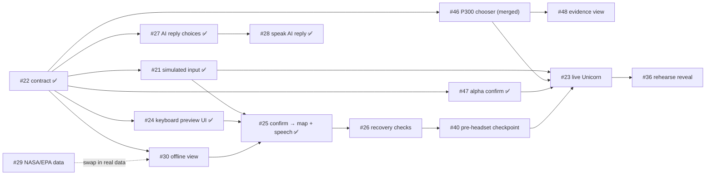

# Selection contract

This is the shared contract from [#22](https://github.com/Order-of-the-Golden-Eagles/Signal2Speech/issues/22). Every input source and every output builds against it. The code is in [`signal2speech/core/`](../../signal2speech/core): pure Python with no g.Pype or Qt imports. The executable spec is [`contracts/selection-scenarios.json`](../../contracts/selection-scenarios.json). If you change a rule, change the scenario file and the code in the same PR.

**Stack:** Python 3.12, [g.Pype](https://gpype.gtec.at) for acquisition, signal processing, and scopes, and PySide6 for the UI. Everything runs in one process with no bridge. g.Pype runs on Windows, macOS, and Linux.

## Current status

What is on `main` as of 2026-11-14. "Simulated" means g.Pype `Generator` or scripted input, never a person.

| Piece | Where | Status |
| --- | --- | --- |
| Selection contract (#22) | `signal2speech/core/`, `contracts/` | Merged. `pytest` runs every scenario and sample event. |
| Keyboard UI and flash scheduler (#24) | `signal2speech/ui/` | Merged. Offscreen tests in `pytest`. |
| Integrated app (#4, #25) | `signal2speech/app.py`, `signal2speech/speech/` | Merged. `--input keyboard` and `--input simulated` give one map action and one spoken line per confirm, and nothing on preview or cancel. The map is a labelled stand-in until #30 lands. |
| Simulated input (#21) | `signal2speech/eeg/simulated.py` | Merged. Real g.Pype `Generator` pipeline, labelled `simulated`. |
| P300 chooser (#46) | `signal2speech/eeg/p300.py` | Merged. Verified on synthetic data only. Not yet wired into `app.py`. **Needs the live headset** for accuracy and trial counts. |
| Alpha-switch confirm (#47) | `signal2speech/eeg/alpha_confirm.py` | Merged. Verified on g.Pype `Generator` only. **Needs the live headset** for the threshold and false triggers. |
| Evidence view (#48) | `signal2speech/evidence/` | Merged. Runs on `Generator` and replay. **Needs the live headset** for real EEG. |
| AI reply choices (#5, #27, #28) | `signal2speech/ai/` | Merged. Stub flow checked by hand. A live Claude call is unverified (no key yet). |
| OpenOrbit data and view (#29, #30) | `data/openorbit/`, `signal2speech/openorbit/` | Not on `main` yet ([PR #65](https://github.com/Order-of-the-Golden-Eagles/Signal2Speech/pull/65)). |
| Live Unicorn input (#23) | Not started | `app.py` refuses `--input live` and `--input recorded`, and live EEG confirm stays disarmed. **Needs the live headset.** |
| CI (#37) | `.github/workflows/tests.yml` | Merged. `pytest` on Windows, macOS, and Ubuntu (Python 3.12, plus 3.13 on Ubuntu). |

## Vendor facts vs. app decisions

| | What we know | Status |
| --- | --- | --- |
| **Vendor fact** | g.Pype 4.2 `HybridBlack` source: Bluetooth, 8 EEG channels at 250 Hz. It needs no licence and no Unicorn Suite. Our `pyproject.toml` installs `gpype[gui,devices]`, h5py, and scikit-learn. Pair the headset in the OS first. | Documented, not yet run by us |
| **Vendor fact** | `HybridBlack(enable_oscar=True)` turns on OSCAR artifact removal. It adds processing delay. | Documented |
| **Vendor fact** | g.Pype has **no ready-made P300 or SSVEP classifier**. The `Sklearn` node offers LDA or logistic regression, trained offline on `Epochs`, and outputs a class index online. | Documented |
| **Vendor fact** | `Marker` emits stimulus codes into a pipeline, and `Keyboard` emits key events. `Generator` simulates signals with no hardware. `UDPSender` and `LSLSender` stream out. | Documented |
| **Vendor fact** | The g.tec Paradigm Presenter is separately licensed and Windows-only. The MCP visualizer shown at the workshop isn't in the public docs. | Ask the g.tec mentor |
| **Unknown** | P300 accuracy and trials needed for our wearer ([#46](https://github.com/Order-of-the-Golden-Eagles/Signal2Speech/issues/46)), the alpha-switch threshold and false triggers ([#47](https://github.com/Order-of-the-Golden-Eagles/Signal2Speech/issues/47)), and whether a late decision can cross rounds ([#23](https://github.com/Order-of-the-Golden-Eagles/Signal2Speech/issues/23)). | Verify |
| **App decision** | Everything below. | Implemented in `signal2speech/core/` and covered by `pytest` |

## How a selection is decoded

```
HybridBlack(enable_oscar=True) or Generator → Bandpass 1–30 Hz
  ├→ Trigger (per tile's flash Marker) → P300Scorer (Sklearn LDA score) → SequenceAggregator → class 1/2 → Choose round   [#46]
  ├→ FFT → BandPower(alpha) → Threshold → rising edge → Confirm (target-1)          [#47]
  └→ TimeSeriesScope, SpectrumScope, EpochAverage → judge evidence view              [#48]
```

- **Choose** uses P300. Our PySide6 tiles flash and send `Marker` codes, and the tile with the highest mean LDA score wins. Calibration cuts epochs with `Epochs` and fits the LDA offline (`gp.Sklearn.fit_offline`).
- **Confirm** uses a deliberate alpha switch: eyes closed for about 2 seconds. Cancel is the keyboard or judge cancel, or a timeout. P300 and the alpha switch are different brain signals, so a leftover P300 can't count as a confirmation.
- **Fallback** if P300 isn't reliable by 8:15: step through the options one at a time and confirm each with the alpha switch.

## Event shape

All input sources produce the same shape:

```json
{"source":"keyboard","roundId":"r1","eventId":"k1","targetId":"target-2"}
```

| Field | Values | Who sets it |
| --- | --- | --- |
| `source` | `keyboard`, `simulated` (g.Pype `Generator` or injected), `recorded` (g.Pype replay), `live-eeg` | The adapter. Label input honestly in logs and the demo. |
| `roundId` | `r1`, `r2`, … | The app issues it, and the adapter stamps it **when the flash sequence starts**, not when the decision arrives. |
| `eventId` | `k1`, `s1`, `rec1`, `e1`, … | The adapter. Unique per run. |
| `targetId` | `target-1`, `target-2` | The adapter maps keys or classifier classes onto it (`EegClassMap.default()`: 1 → `target-1`, 2 → `target-2`). |

In Python, this is `SelectionEvent`. Its field names match the JSON so `SelectionEvent.from_dict()` maps 1:1.

## IDs

**Targets** are on-screen tiles. Their meaning changes with each round.

| Round kind | `target-1` | `target-2` |
| --- | --- | --- |
| Choose (OpenOrbit demo, [`demo-round.json`](../../contracts/demo-round.json)) | `show_satellite` | `compare_air_quality` |
| Choose (AI Answering, #27) | `speak_reply` (reply A) | `speak_reply` (reply B) |
| Confirm (always) | `confirm` (alpha switch or key 1) | `cancel` (key 2, Esc, or timeout) |

**Actions** are stable strings in `ActionIds`. Only these three ever reach output:

| Action | Effect after confirmation |
| --- | --- |
| `show_satellite` | Show the June 28 NASA MODIS image and speak its line. |
| `compare_air_quality` | Show the June 26 and June 28 imagery with the county AQI comparison, then speak "Washtenaw's AQI rose 186 points. Wayne's rose 168 points." |
| `speak_reply` | Speak the exact previewed reply. |

## Round rules (`SelectionHandler`)



1. The app opens a round with frozen options. Each round gets a new ID.
2. The first valid event **consumes** the round before any UI update or effect runs.
3. In a Choose round, a valid pick only previews. The handler stores the exact text with the action ID and opens a Confirm round.
4. A fresh Confirm sends a `ConfirmedAction` to the sink exactly once and clears the pending choice. The app then calls `begin_choice_round` for the next question.
5. These are rejected without output. The round stays as it was:

| Outcome | Cause |
| --- | --- |
| `RejectedStaleRound` | The `roundId` doesn't match the open round. This includes a late decision from the Choose round. |
| `RejectedDuplicateEvent` | The `eventId` was already accepted. |
| `RejectedRoundConsumed` | The round already accepted an event. |
| `RejectedNoOpenRound` | Nothing is on screen, for example after a confirm, cancel, or disconnect. |
| `RejectedUnknownTarget` / `RejectedUnknownSource` / `RejectedMalformed` | The input doesn't match the contract. |
| `RejectedLiveConfirmDisarmed` | A `live-eeg` Confirm arrived while `live_eeg_confirm_armed` is False (the default). Keyboard can still confirm. #23 decides when to arm it. |

### Sample events

Use these against [`demo-round.json`](../../contracts/demo-round.json):

| File | Event | Result |
| --- | --- | --- |
| [`preview.json`](../../contracts/events/preview.json) | `keyboard`, `r1`, `k1`, `target-2` | `Previewed` "Compare counties". Opens Confirm round `r2`. No output. |
| [`stale.json`](../../contracts/events/stale.json) | `live-eeg`, `r1`, `e7`, `target-1` | `RejectedStaleRound`. A late `r1` decision can't confirm in `r2`. |
| [`confirm-fresh.json`](../../contracts/events/confirm-fresh.json) | `keyboard`, `r2`, `k2`, `target-1` | `Confirmed`. One `compare_air_quality` effect and one spoken line. |

## Plugging in

```python
from signal2speech.core import SelectionHandler, InputAdapter, InputSources, EegClassMap, TargetIds

handler  = SelectionHandler(sink)                     # sink.execute(action), owned by #25
keyboard = InputAdapter(handler, InputSources.KEYBOARD)
eeg      = InputAdapter(handler, InputSources.LIVE_EEG)   # SIMULATED for Generator, RECORDED for replay
classes  = EegClassMap.default()

handler.on_round_opened.append(ui.show_round)         # #24
handler.on_preview.append(ui.show_preview)            # #24: no audio, no map change
handler.on_cleared.append(ui.reset)
handler.on_handled.append(log.write)                  # #41 diagnostics and judge strip

handler.begin_choice_round(demo_choices)
keyboard.select_now(TargetIds.TARGET_2)               # keys 1 and 2
eeg.arm_capture()                                     # when the tiles start flashing (window.flasher.on_sequence_started)
eeg.select_captured(classes.target_for(lda_class))    # from the g.Pype output, on the Qt main thread
```

- **Threading:** g.Pype runs nodes on worker threads, and `SelectionHandler` isn't thread-safe. Emit a Qt signal from your g.Pype sink and call the adapter in the slot. The custom-node API is in g.Pype examples `s7e1` and `s7e2`.
- **Ready-made wiring:** `P300Chooser(build_pipeline(...), adapter).attach(window.flasher)` in `signal2speech/eeg/p300.py` arms capture, sends the flash Markers, and hops to the Qt main thread for you. `SimulatedDecoder` in `signal2speech/eeg/simulated.py` does the same for `Generator` input, and `app.py` uses it for `--input simulated`.

## Tests

```
py -3.12 -m venv .venv && .venv\Scripts\activate
pip install -e ".[dev]"
pytest
```

For the exact pinned versions, use `pip install -r requirements-lock.txt`. On a headless machine, set `QT_QPA_PLATFORM=offscreen`.

- `tests/test_contract.py` runs the scenario file, the sample events, and the adapter checks in under a second.
- The full suite (`tests/` plus `signal2speech/ui/tests/`) runs in about a minute; on 2026-11-14 it was 111 passed and 2 skipped on Windows. The count grows as PRs land, so trust the latest CI run over this number. It needs no headset: EEG tests use g.Pype `Generator` or synthetic recordings.
- CI runs the same `pytest` on every PR on Windows, macOS, and Ubuntu ([`tests.yml`](../../.github/workflows/tests.yml), #37).
- Git hooks (secret and raw-EEG scan before commit, `pytest` before push) are in [`.githooks/`](../../.githooks/) (#37). Turn them on once per clone with `git config core.hooksPath .githooks`.

## Repo layout and ownership

Each track owns one folder, so parallel PRs don't conflict. Don't edit another track's folder without telling its owner.

| Path | Owner issue | Notes |
| --- | --- | --- |
| `contracts/`, `signal2speech/core/`, `tests/test_contract.py` | #22 | Shared. Changes need a scenario update and a heads-up to every track. |
| `pyproject.toml`, `docs/dev-setup-docs/` | #19 | Environment and launch path |
| `signal2speech/eeg/` | #21, #46, #47, #23 | One file per issue: `simulated.py` (#21), `p300.py` (#46), `alpha_confirm.py` (#47), live run (#23, not started) |
| `signal2speech/evidence/` | #48 | Judge evidence window and record/replay |
| `signal2speech/ui/` | #24 | PySide6 tiles, preview, judge strip, keys 1 and 2, and the P300 flash scheduler (`flash.py`) |
| `data/openorbit/` | #29 | MODIS images, AQI rows, `SOURCES.md` (in PR #65) |
| `signal2speech/openorbit/` | #30 | Comparison view. Exposes `show_satellite` and `compare_air_quality` (in PR #65). |
| `signal2speech/speech/`, `signal2speech/app.py` | #4, #25 | Sink implementation, audio, and the one integration entry point (`python -m signal2speech.app`) |
| `signal2speech/ai/` | #5, #27, #28 | Reply suggestions as `speak_reply` choices (`python -m signal2speech.ai`) |
| `tests/test_<track>.py` | Each track | One test file per track, for example `test_p300.py` for #46 |

## Dependency order



GitHub tracks the solid edges as **Blocked by** relationships (checked 2026-11-14). ✅ means the issue is closed. #46 is merged but stays open until the live check. #25 merged before #30, using a labelled stand-in map. #19 (environment) blocks nothing: each dev follows the launch path on their own machine. #30 starts with placeholder images, so its link to #29 is soft.
